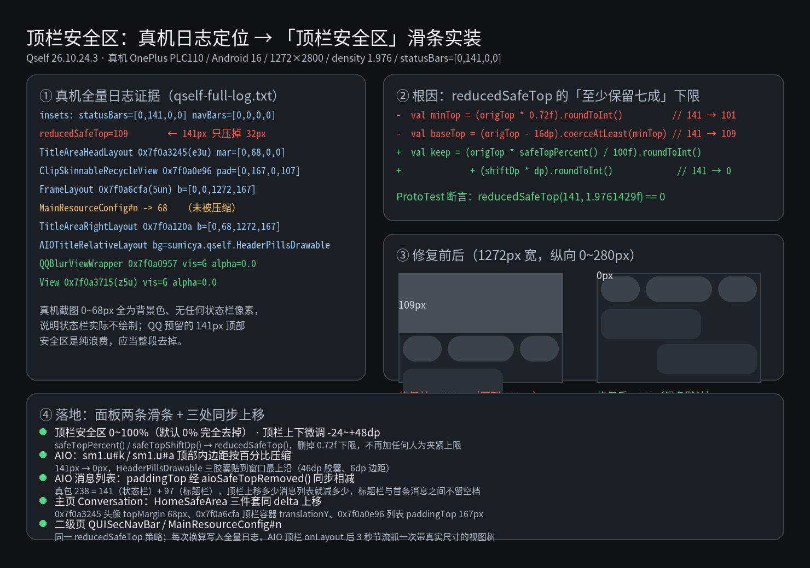

# 消息外观与上游功能核对

本轮优先修复真实异常，再加入有明确用途、可独立关闭和恢复的消息功能。未将所有上游功能默认搬入，也未重建 QQ 输入区或消息层级。

## 实现范围

| 项目 | 本轮实现 | 边界 |
| --- | --- | --- |
| 聊天顶栏与二级页导航栏 | 照 NagramXF `ActionBar.setupGlass` + `ChatAvatarContainer` 三胶囊（`p=6dp`、`s=46dp`、`r=23dp`、中胶囊 `42dp` 圆形会话头像 + 左对齐 `17.5sp`/`13.5sp` 标题副标题 + 内联听筒图标 `0x7f0a1630`），接入 `AIOUtil#b`/`A`/`C`/`D`、隐藏 `reserve1.blur.f`（`sm1.t#a`）通栏模糊、`reserve1.mask.b`（`sm1.y#a`）渐变遮罩、`sm1.u#d`（`0x7f0a152e` `1px` 底边线）与 `sm1.u#q`（`0x7f0a7514` `upMask`），拦截 `AIOTitleVB#H1`/`I1`/`w1`/`P1`/`X1` 防止 UI Handler 异步重设 `#25272d` 实色背景，保留 `sm1.u#f`（`0x7f0a2ec2` `TextView`）返回箭头背景并在夜间模式提亮（`backgroundTintList = #F2F5FA`），移除失效的旧 `TouchDelegate` 并在 `ViewGroup#dispatchTouchEvent` 令三枚胶囊外间隙直接返回 `false` 透传给底层消息列表滑动；同时挂钩 `MainResourceConfig#n`/`p`、`TitleAreaHeadLayout#k`、`SimpleModeHelper#u`/`A`（`0x7f0a6596` `mStatusTitleDivider`）、`SkinnableRecycleView#dispatchDraw`（`f = false`）与二级页导航栏 `QUISecNavBar`（`SecNavBarState`，覆盖 `S`/`T`/`U`/`W`/`X`/`C`/`Q`/`R`/`Z` 并清理按钮圆底）及搜索栏 `QUISearchBar`（`SearchBarState`） | 头像经 `com.tencent.qqnt.avatar.a` 从 `AIOContact` 异步加载，关闭完整恢复；真机视觉待复验 |
| 原生菜单与面板 | `QQCustomMenuExpandableLayout` 重排为 12dp 圆角纵向 `ActionBarPopupWindow` 列表（48dp 行高、18dp 左右内边距、0dp 上下内边距、20dp 图标 + 16sp 完整文案、6dp 按压圆角，保持聊天列表 `T: mSourceView` 可见且 `C = 220dp` 不裁高），随指单有效项高亮、移出取消、危险项标红 | 面板不整块按压缩放，正常底栏透镜不变；真机手势待复验 |
| 转发人数 | 私有方法按完整签名 declared + accessible 查找；同步原生搜索勾选 | 真包可访问性不证明服务端无限制 |
| 消息行、气泡与时间 | 仅对气泡收发模板（`template.g` / `template.l`）套用行几何，居中灰字提示（`template.m` / `sm1.z`）保持原生居中且撤回变灰字时自动解绑连发；他人消息居左（头像左距 8dp、气泡左距 6dp，保留 `WRAP_CONTENT` 与清零 `msgAvatar` 顶内边距防止侵入气泡或下行 `LVxx` 头衔）、自己消息保持原生居右与右侧头像并在连发组首右对齐显示头衔+昵称 ID（续条折叠）；全部消息气泡保持四角全圆角（`17dp`，不切直角）、四向内边距严格统一 `5dp`（归零 `skin.padding.j` `a,b,c,d=0` 与 `skin.padding.h` `j,k,l,n,o=0, m=4dp`，递归清零 `f3()`/`G2()`/`0x7f0a5c31`/`0x7f0a5c11`/`j2()`/`m2()`/`l2()` 内边距、四向 `margin` 与 `57dp × 65dp` 最小宽高锁，并关闭 `TextView` 与 `FasterTextView#mIncludePad` 的 `includeFontPadding`）；被回复消息彻底清除 `0x7f0a5c31` 外框与左竖条，与回复正文融为单一外层玻璃气泡；自定义格式时间（`ExternalStamp`）统一挂载于 `msgContent`（`0x7f0a11b9`）容器底部外侧（他人左对齐 `START`、自己右对齐 `END`）并将同容器兄弟内容根的 `MATCH_PARENT` 宽度转为 `WRAP_CONTENT` 防止压窄图片/表情/卡片/短文本，同时折叠顶部 `AIOTimestampComponent`；面板附带 `DateTimeFormatter` 格式码说明 | 不改文字数据和复制内容；气泡圆角与头像圆角滑块解耦；关闭/复用恢复；真机视觉待复验 |
| 输入区 | 接入 `InputEditTextVBDelegate.U`（`adorn.e#a` 编辑器与 `adorn.e#d` 发送按钮）、`AIOInputExpandableVB`、`compat.b`（`handleUIState`/`e`/`g`/`i`/`n` 全路径防回退）、`compat.e$b#f`（发送按钮原生半高胶囊圆角）、`BottomBlurVB`、`AIOShortcutBarVB`（`onCreateView`/`handleUIState`/`x1`/`y1`/`s1` 拦截异步背景回写）与 `PanelIconLinearLayout#f`，将 `AIOEditText` 与右侧 `AIOInputSendBtn`（含 `com.tencent.qui.smoothcorner.b#j`）分别独立按 `height / 2` 完全药丸化（`capsule()`），去除实色安全区背景后重定位输入区与聊天列表（`RecyclerView` `clipToPadding = false`），并在夜间模式主动提亮玻璃材质、文字与全部快捷操作图标 | 保留全部原生按钮与层级；真机键盘交互待复验 |
| At 对象 | 群消息按 TextElement 元素顺序匹配；UIN 或缓存 UID 映射打开资料卡 | 原有点击段优先；保留长按和滑动；无 UID 映射明确报错，不猜 QQ 号 |
| 头像圆角 | 普通聊天（`RoundRectImageView#draw` 下拦截 `QQProAvatarDrawable#z` 跳过 `proavatar.j#b` / `proavatar.mask.a#a` 的 360° 圆形 `Path.addArc` 遮罩，结合 `proavatar.e$a#a`、`meta.b$a#b`、`b$a#i` 与 `BaseImageUtil#getCircleFaceBitmap`）与聊天记录统一走 `RoundRectImageView`，0～50%，默认 20% | 0% 为直角，50% 为圆形（仅作用于头像，不联动气泡）；关闭清空 `m` 缓存重刷并还原原值 |
| 头像定位 | 单条独立消息保持原生顶对齐不居中（`runAvatarBounds` 在 `merged == false` 时返回 `null`，避免异步高度变化跳动与向下侵入）；仅连发多条消息（`>= 2`）按组上下边界 `[groupTop + h/2, max(groupTop + h/2, groupBottom - h/2)]` 粘性滚动合并 | 不代表全部真实列表回收/滚动问题已经验收 |

## 需求对齐渲染预览图

设置入口：菜单内部「消息外观」。自定义格式单行输入，不再加字符长度硬限制；非法格式不写入偏好。面板提供头像圆角（`0~50%`）、玻璃模糊（`0~15dp`）、气泡圆角（`0~32dp`）、气泡边距（`0~16dp`）、顶栏安全区（`0~100%`，默认 `0%` 完全去掉）、顶栏上下微调（`-24~+48dp`）共 6 项滑条，「恢复默认」同步还原全部参数。顶栏安全区滑条驱动 `safeTopPercent()` / `safeTopShiftDp()` → `reducedSafeTop()`，AIO 顶栏内边距、消息列表顶部内边距、主页 `HomeSafeArea` 三件套与二级页 `QUISecNavBar` 全部按同一 `delta` 上移。消息内时间、At 对象、头像圆角、双击回应、语音倍速记忆、页面过渡动效分别有开关；头像连发浮绘与长按 `@` 微震由「连发合并」控制。

## 上游核对与取舍

实际读取 QAuxiliary [`4791fc9615b766808aae31b28d67854d02f5fac5`](https://github.com/cinit/QAuxiliary/tree/4791fc9615b766808aae31b28d67854d02f5fac5)：

- `me/ketal/hook/ShowMsgAt.kt` 的功能名是「消息显示At对象」，不是给输入框新增 At 面板。参考其功能含义，本仓依据 QQ 9.2.10 的实际组件独立实现；不引入其运行库或复制其代码。
- `cc/ioctl/hook/chat/CustomMsgTimeFormat.java` 修改的是原生时间格式，不是消息内的独立时间行；本仓按本次需求自行预留并绘制时间行。
- `cc/ioctl/hook/chat/RoundAvatarHook.java` 明确仅支持 QQ 8.8.11 以下，不照搬到当前 QQ；改用当前原生圆角接口。
- `io/github/memory2314/hook/RemoveShareLimit.kt` 作为行为参考；本仓使用真包已有的 `setSearchSelectedAndJoinedUins()`，不复制上游对搜索对象的假定。

尚未逐项评估的其他上游功能不默认新增；优先保证当前功能的实际生效、关闭恢复和列表复用。

## 真包证据与验证

只读 QQ APK SHA-256：`34bdea66e738062c3f762f7da98132addc7170394605a4f5ca1944bee1280c84`，37 个 DEX。`tools/symbols.txt` 检查名称，`tools/ui_paths.py` 检查完整签名、字段读写、调用边及私有访问标记。

圆角模式不是位掩码：`RoundRectImageView.checkPathChanged` 中 mode=1 的分支调用四角等半径 `Path.addRoundRect(RectF, float, float, Direction)`；脚本对此增加固定真包指令检查。

实际运行记录以对应提交 CI 为准。纯逻辑测试验证时间格式、时区、非法输入、圆角范围、重复名字和 UTF-16 偏移；源码契约验证恢复、触摸取消和原生链接保留。这些不能证明设备效果，尤其需要复验：普通文字长短消息/引用/表情、大字体、消息复制与长按、滚动回收、头像点击与圆角、开关恢复、转发搜索勾选以及资料卡跳转。

## 分支历史

主分支唯一未包含的提交为 `f9c1fc06939d0692f284c90db23fa97d2c5791ad`，只删除旧 `spec-check.yml`。本轮正常合入该历史，保留本分支同样的删除结果；不隐藏提示、不改默认分支、不重写已出包历史。推送后以 GitHub compare 的 behind_by 复核。
